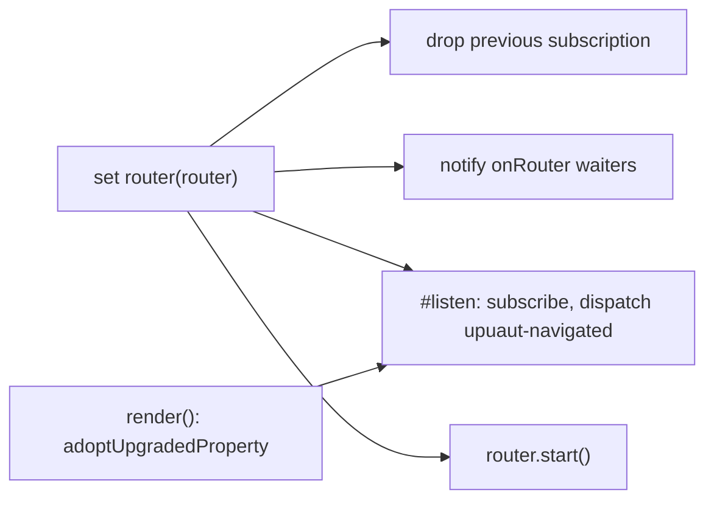
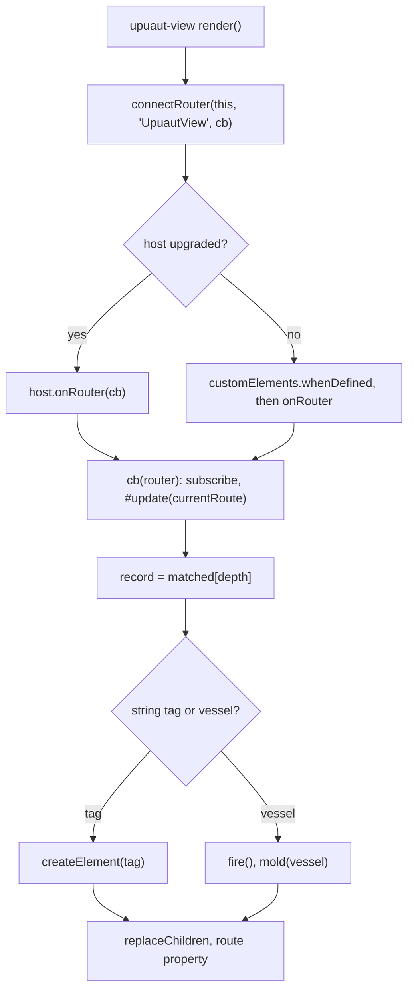
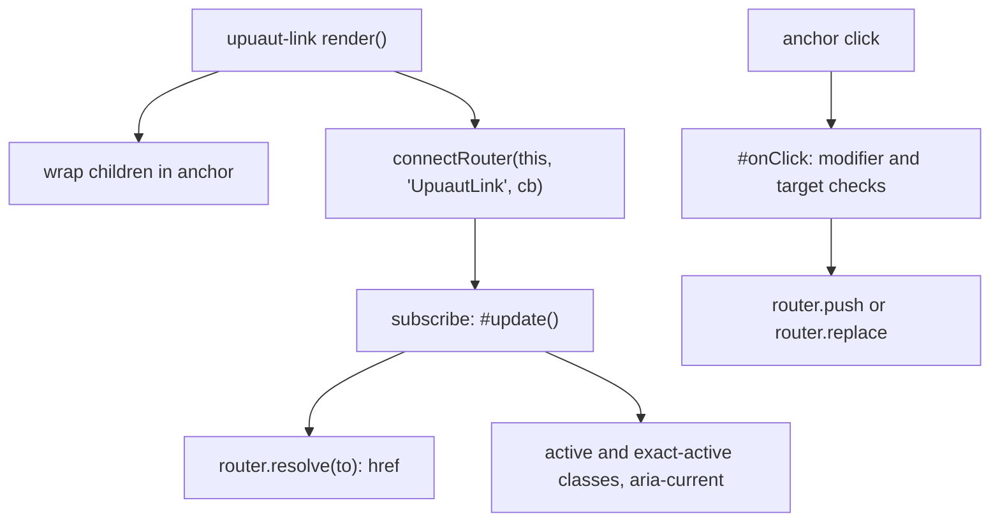

# components

## Purpose

Three custom elements built on khnum `Shape`: `<upuaut-router>` owns a Router and broadcasts navigation as `upuaut-navigated` events; `<upuaut-view>` renders the matched record for its depth; `<upuaut-link>` renders an anchor that navigates on click and tracks active classes.
Views and links find the router with `connectRouter()`, which walks ancestors to the nearest `<upuaut-router>` and waits for its upgrade. `host.ts` holds the shared tag names and helpers.

## Flows

Router element wiring:

View rendering:

Link behaviour:

## Key symbols

| Symbol                | Kind      | Path                             | Grep anchor                                              | Role                                                                    |
| --------------------- | --------- | -------------------------------- | -------------------------------------------------------- | ----------------------------------------------------------------------- |
| ROUTER_TAG            | const     | src/components/host.ts           | `export const ROUTER_TAG =`                              | Tag name `upuaut-router`.                                               |
| VIEW_TAG              | const     | src/components/host.ts           | `export const VIEW_TAG =`                                | Tag name `upuaut-view`.                                                 |
| RouterHost            | interface | src/components/host.ts           | `export interface RouterHost extends Element {`          | Element shape with `onRouter(cb)`; used to detect upgrade.              |
| ancestors             | function  | src/components/host.ts           | `export function ancestors(`                             | Walks up the DOM, crossing shadow boundaries via host.                  |
| connectRouter         | function  | src/components/host.ts           | `export function connectRouter(`                         | Finds nearest router host, calls cb now or after upgrade; returns stop. |
| adoptUpgradedProperty | function  | src/components/host.ts           | `export function adoptUpgradedProperty(`                 | Re-applies a property set before the element was upgraded.              |
| NavigatedEvent        | const     | src/components/router-element.ts | `export const NavigatedEvent =`                          | ChangedEvent `upuaut-navigated`, bubbles.                               |
| UpuautRouter          | class     | src/components/router-element.ts | `export class UpuautRouter`                              | `<upuaut-router>`: holds the Router, emits navigation events.           |
| UpuautRouter.router   | accessor  | src/components/router-element.ts | `  set router(router: Router`                            | Setter: rewires subscription, notifies waiters, calls start().          |
| UpuautRouter.onRouter | method    | src/components/router-element.ts | `  onRouter(cb: (router: Router) => void): () => void {` | Registers a waiter; returns unsubscribe.                                |
| UpuautView            | class     | src/components/view.ts           | `export class UpuautView extends`                        | `<upuaut-view>`: renders the matched component at its depth.            |
| UpuautView.#update    | method    | src/components/view.ts           | `  #update(route: RouteLocation): void {`                | Picks matched[depth], rebuilds child only when the record changes.      |
| UpuautLink            | class     | src/components/link.ts           | `export class UpuautLink extends Shape<LinkProps>(`      | `<upuaut-link>`: anchor with active classes and click navigation.       |
| LinkProps             | type      | src/components/link.ts           | `type LinkProps = {`                                     | Attributes: to, replace, target, active-class, exact-active-class.      |
| DEFAULT_ACTIVE_CLASS  | const     | src/components/link.ts           | `export const DEFAULT_ACTIVE_CLASS =`                    | Default active class `upuaut-link-active`.                              |
| UpuautLink.#update    | method    | src/components/link.ts           | `  #update(): void {`                                    | Recomputes href, target and active classes from current route.          |
| UpuautLink.#onClick   | method    | src/components/link.ts           | `  #onClick(event: MouseEvent): void {`                  | Ignores modified or non-primary clicks; otherwise push or replace.      |

## Dependencies

| Direction | Area   | Through                                                                                    |
| --------- | ------ | ------------------------------------------------------------------------------------------ |
| out       | router | `Router` type, `isLazyComponent`, instance methods subscribe, resolve, start, currentRoute |
| out       | core   | UpuautError (host.ts); RouteLocation, RouteRecord (types)                                  |
| out       | khnum  | `Shape`, `mold`, `ChangedEvent`                                                            |
| in        | demo   | `<upuaut-router>` element, `UpuautRouter` class, `UpuautView`, `UpuautLink`                |
