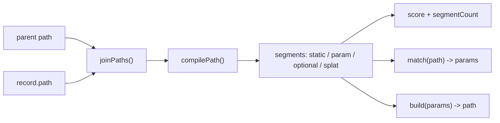

# core

## Purpose

Shared, dependency-light building blocks: public types (`src/types.ts`), the error class and navigation failure shape (`src/errors.ts`), query string codec (`src/query.ts`) and path pattern compiler (`src/path.ts`).
Other areas import these; core imports only khnum (`Vessel`, `KhnumError`).

## Flows

Route path compilation:

Query codec:

## Key symbols

| Symbol              | Kind      | Path          | Grep anchor                                     | Role                                                                               |
| ------------------- | --------- | ------------- | ----------------------------------------------- | ---------------------------------------------------------------------------------- |
| Query               | type      | src/types.ts  | `export type Query =`                           | Query string record (string or string array values).                               |
| RouteRecord         | interface | src/types.ts  | `export interface RouteRecord {`                | Route config: path, component, redirect, beforeEnter, children, meta.              |
| RouteLocation       | interface | src/types.ts  | `export interface RouteLocation {`              | Resolved location: path, fullPath, params, query, hash, meta, matched chain.       |
| RouteLocationRaw    | type      | src/types.ts  | `export type RouteLocationRaw =`                | Input to push, replace and resolve: string, path object or named object.           |
| NavigationGuard     | type      | src/types.ts  | `export type NavigationGuard = (`               | Guard `(to, from)` returning void, boolean or a redirect location.                 |
| RouteComponent      | type      | src/types.ts  | `export type RouteComponent =`                  | Khnum vessel, registered plain custom element class, or tag name.                  |
| LazyRouteComponent  | type      | src/types.ts  | `export type LazyRouteComponent =`              | Loader returning a component or `{default}` module.                                |
| UpuautError         | class     | src/errors.ts | `export class UpuautError extends KhnumError {` | Error with the failing function name as prefix.                                    |
| NavigationFailure   | interface | src/errors.ts | `export interface NavigationFailure {`          | Outcome object with type `aborted`, `cancelled` or `duplicated`, plus from and to. |
| isNavigationFailure | function  | src/errors.ts | `export function isNavigationFailure(`          | Type guard for navigation failure values.                                          |
| parseQuery          | function  | src/query.ts  | `export function parseQuery(`                   | Parses a `?a=1&a=2` string into a Query.                                           |
| stringifyQuery      | function  | src/query.ts  | `export function stringifyQuery(`               | Serializes a Query back to a `?...` string.                                        |
| CompiledPath        | interface | src/path.ts   | `export interface CompiledPath {`               | Compiled pattern: `match(path)`, `build(params)`, `score`, `segmentCount`.         |
| compilePath         | function  | src/path.ts   | `export function compilePath(`                  | Compiles a route pattern (`:id`, `:id?`, `:rest*`) into a CompiledPath.            |
| joinPaths           | function  | src/path.ts   | `export function joinPaths(`                    | Joins a parent and child route path.                                               |

## Dependencies

| Direction | Area       | Through                                                       |
| --------- | ---------- | ------------------------------------------------------------- |
| out       | khnum      | `Vessel` type (types.ts), `KhnumError` base class (errors.ts) |
| in        | router     | errors, path, query, types                                    |
| in        | components | errors (host.ts), types (view.ts, router-element.ts)          |
| in        | demo       | public API via `src/index.ts` re-exports                      |
