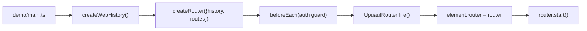
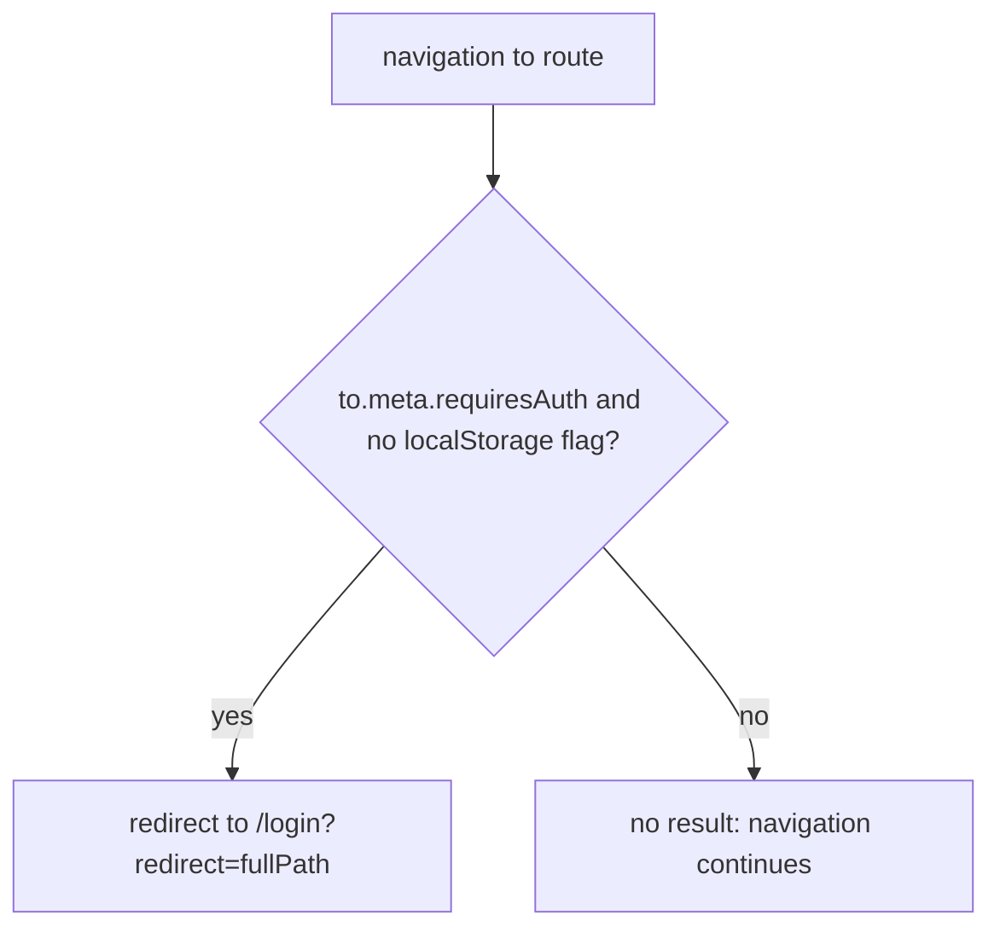
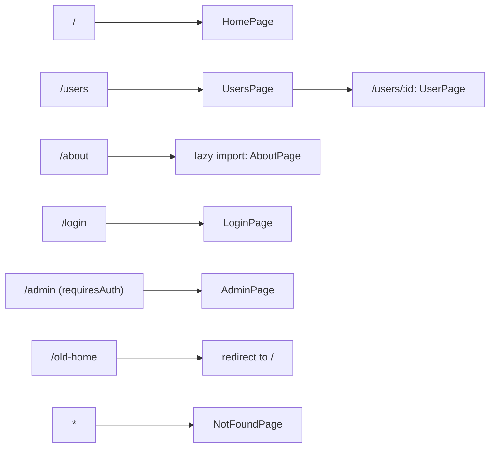

# demo

## Purpose

Vite SPA (`demo/`, alias `upuaut` to `src/index.ts`) that exercises the library end to end.
`demo/main.ts` builds the router with web history, a route table, an auth guard on `meta.requiresAuth`, and mounts it on `<upuaut-router>`.
Pages in `demo/pages/*.ts` are khnum `Shape` components; `about.ts` is the lazy-loaded default export.

## Flows

Bootstrap:

Auth guard:

Route table (path to page):

## Key symbols

| Symbol       | Kind  | Path                    | Grep anchor                                                                  | Role                                                                                 |
| ------------ | ----- | ----------------------- | ---------------------------------------------------------------------------- | ------------------------------------------------------------------------------------ |
| route table  | const | demo/main.ts            | `    {path: "/old-home", redirect: "/"},`                                    | Route table entry for the redirect; the router is built around it in `createRouter`. |
| auth guard   | call  | demo/main.ts            | `to.meta.requiresAuth && localStorage.getItem("upuaut-demo-auth")`           | Redirects `requiresAuth` routes to /login when not signed in.                        |
| bootstrap    | call  | demo/main.ts            | `(document.querySelector("upuaut-router") as UpuautRouter).router = router;` | Attaches the router to the `<upuaut-router>` element.                                |
| HomePage     | class | demo/pages/home.ts      | `export class HomePage extends Shape("demo-home")`                           | Page for `/`.                                                                        |
| UsersPage    | class | demo/pages/users.ts     | `export class UsersPage extends Shape("demo-users")`                         | Page for `/users`, hosts the `:id` child view.                                       |
| USERS        | const | demo/pages/users.ts     | `const USERS = [`                                                            | Fixture data for the users list.                                                     |
| UserPage     | class | demo/pages/user.ts      | `export class UserPage extends Shape("demo-user")`                           | Page for `/users/:id`, reads route params.                                           |
| LoginPage    | class | demo/pages/login.ts     | `export class LoginPage extends Shape("demo-login")`                         | Page for `/login`, target of the auth redirect.                                      |
| AdminPage    | class | demo/pages/admin.ts     | `export class AdminPage extends Shape("demo-admin")`                         | Page for `/admin`, guarded by `meta.requiresAuth`.                                   |
| AboutPage    | class | demo/pages/about.ts     | `export default class AboutPage extends Shape("demo-about")`                 | Lazy-loaded page for `/about`.                                                       |
| NotFoundPage | class | demo/pages/not-found.ts | `export class NotFoundPage extends Shape("demo-not-found")`                  | Catch-all page for `*`.                                                              |

## Dependencies

| Direction | Area       | Through                                                                               |
| --------- | ---------- | ------------------------------------------------------------------------------------- |
| out       | router     | `createRouter`, `beforeEach`, `start`, via the `upuaut` alias                         |
| out       | history    | `createWebHistory`                                                                    |
| out       | components | `UpuautRouter` element and `fire()`; `UpuautView` and `UpuautLink` via page templates |
| out       | khnum      | `Shape`, `mold` in every page                                                         |
| in        | none       | SPA entry point; Vite root                                                            |
