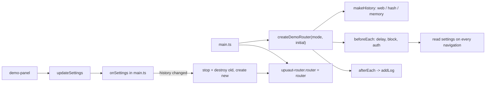
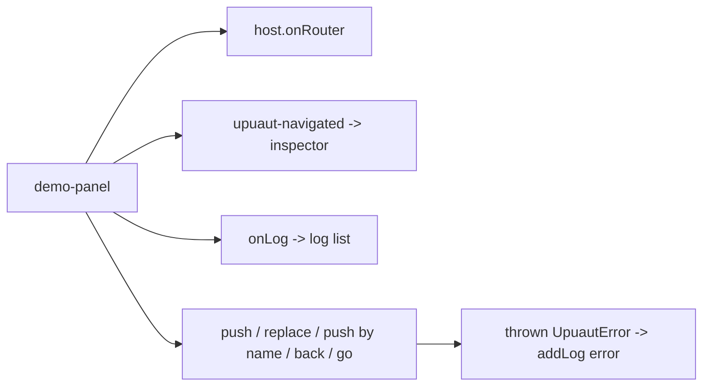

# demo

## Purpose

Demo SPA showing every router feature: nested, lazy, query, optional, splat, hash, guards, redirects.
`<demo-panel>` changes router behavior live (history mode, guards, delays) and shows route + log.
Settings persist in localStorage; a history change swaps the Router on `<upuaut-router>`.

## Flows

## Key symbols

| Symbol           | Kind     | Path                 | Grep anchor                                                  | Role                                        |
| ---------------- | -------- | -------------------- | ------------------------------------------------------------ | ------------------------------------------- |
| createDemoRouter | function | demo/router.ts       | `export function createDemoRouter(`                          | Routes, guards and afterEach log            |
| makeHistory      | function | demo/router.ts       | `function makeHistory(`                                      | History per mode; rewrites URL first        |
| block guard      | call     | demo/router.ts       | `router.beforeEach((_to, from) =>`                           | Aborts when "block" is on                   |
| log hook         | call     | demo/router.ts       | `router.afterEach((to, from, failure) => {`                  | Writes successes and failures to the log    |
| router swap      | call     | demo/main.ts         | `onSettings((next, changed) => {`                            | Replaces the Router on history change       |
| DemoPanel        | class    | demo/panel.ts        | `export class DemoPanel extends Shape("demo-panel")`         | Control panel, inspector, log               |
| settings         | const    | demo/settings.ts     | `export const settings: DemoSettings`                        | Live settings read by guards                |
| updateSettings   | function | demo/settings.ts     | `export function updateSettings(`                            | Patch, persist, notify                      |
| addLog           | function | demo/log.ts          | `export function addLog(`                                    | Append a log entry (max 50)                 |
| RoutedPage       | function | demo/util.ts         | `export function RoutedPage(`                                | Base page that re-renders on `route` change |
| SearchPage       | class    | demo/pages/search.ts | `export class SearchPage extends`                            | Query demo `/search?q=`                     |
| PostsPage        | class    | demo/pages/posts.ts  | `export class PostsPage extends`                             | Optional param `/posts/:slug?`              |
| FilesPage        | class    | demo/pages/files.ts  | `export class FilesPage extends`                             | Splat `/files/:rest*`                       |
| DocsPage         | class    | demo/pages/docs.ts   | `export class DocsPage extends`                              | Hash sections `/docs#id`                    |
| UsersPage        | class    | demo/pages/users.ts  | `export class UsersPage extends Shape("demo-users")`         | Layout with nested `<upuaut-view>`          |
| UserPage         | class    | demo/pages/user.ts   | `export class UserPage extends Shape("demo-user")`           | `/users/:id`, reused on param change        |
| AboutPage        | class    | demo/pages/about.ts  | `export default class AboutPage extends Shape("demo-about")` | Lazy page                                   |

## Dependencies

| Direction | Area       | Through                                                                              |
| --------- | ---------- | ------------------------------------------------------------------------------------ |
| out       | router     | `createRouter`, `START_LOCATION`, Router methods                                     |
| out       | history    | `createWebHistory`, `createHashHistory`, `createMemoryHistory`                       |
| out       | components | `UpuautRouter` (`fire`, `router`, `onRouter`), `upuaut-link`/`upuaut-view` in markup |
| out       | khnum      | `Shape`, `mold`                                                                      |
| in        | e2e, tests | e2e/demo.spec.ts, e2e/panel.spec.ts, tests/demo.test.ts                              |
