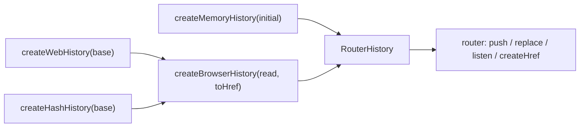
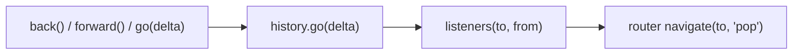

# history

## Purpose

Defines the `RouterHistory` contract (location, push, replace, go, listen, createHref, destroy) that the router drives.
Ships three factories: in-memory, web (base path) and hash. Web and hash share one private browser implementation.
No in-repo imports; the router receives a history instance through `RouterOptions`.

## Flows

Factory selection:

Pop (back, forward or go) path into the router:

## Key symbols

| Symbol               | Kind      | Path           | Grep anchor                            | Role                                                                        |
| -------------------- | --------- | -------------- | -------------------------------------- | --------------------------------------------------------------------------- |
| RouterHistory        | interface | src/history.ts | `export interface RouterHistory {`     | Contract the router depends on.                                             |
| HistoryListener      | type      | src/history.ts | `export type HistoryListener =`        | Callback `(to, from)` fired on history changes.                             |
| createMemoryHistory  | function  | src/history.ts | `export function createMemoryHistory(` | In-memory stack with index; for tests and non-browser use.                  |
| createWebHistory     | function  | src/history.ts | `export function createWebHistory(`    | Browser history with a base path (demo uses it).                            |
| createHashHistory    | function  | src/history.ts | `export function createHashHistory(`   | Hash-based browser history.                                                 |
| createBrowserHistory | function  | src/history.ts | `function createBrowserHistory(`       | Private shared implementation: `read()` for location, `toHref()` for hrefs. |

## Dependencies

| Direction | Area   | Through                                                               |
| --------- | ------ | --------------------------------------------------------------------- |
| in        | router | `RouterHistory` type; push, replace, go, listen, createHref, location |
| in        | demo   | `createWebHistory()` passed to `createRouter`                         |
| in        | core   | none (history has no imports)                                         |
