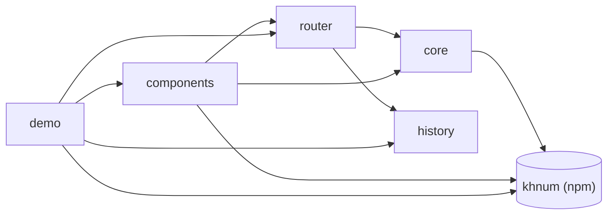

# Upuaut project map

Overview of the five areas. `src/index.ts` re-exports the public API of core, history, router and components (no area of its own).

| Area       | Map                            | Purpose                                                                                        |
| ---------- | ------------------------------ | ---------------------------------------------------------------------------------------------- |
| core       | [core.md](core.md)             | Shared types, error class, query string and path pattern helpers.                              |
| history    | [history.md](history.md)       | `RouterHistory` contract and the memory, web and hash implementations.                         |
| router     | [router.md](router.md)         | `createRouter()`: route matching, navigation pipeline, guards, hooks and subscriptions.        |
| components | [components.md](components.md) | `<upuaut-router>`, `<upuaut-view>` and `<upuaut-link>` custom elements built on khnum `Shape`. |
| demo       | [demo.md](demo.md)             | Vite SPA that exercises the library: routes, guard, lazy page, redirect, catch-all.            |
