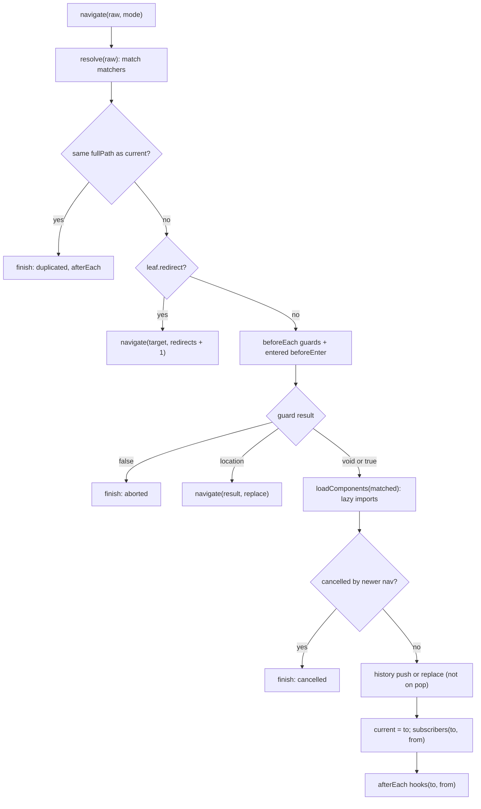
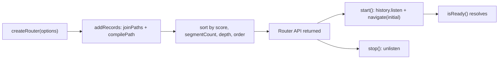

# router

## Purpose

`createRouter(options)` compiles `routes` into matchers sorted by specificity, and returns the `Router` API: push, replace, resolve, guards, hooks, subscriptions and start or stop against a history.
All navigation runs through one closure, `navigate`, which applies duplicate check, redirects, guards, lazy loading, history write, listeners and afterEach hooks in that order.
Navigation is cancelled by a newer `navigationId`; redirects are capped at `MAX_REDIRECTS`.

## Flows

`navigate()` pipeline:

Setup and lifecycle:

## Key symbols

| Symbol           | Kind      | Path          | Grep anchor                                  | Role                                                                                 |
| ---------------- | --------- | ------------- | -------------------------------------------- | ------------------------------------------------------------------------------------ |
| createRouter     | function  | src/router.ts | `export function createRouter(`              | Builds matchers and returns the Router.                                              |
| Router           | interface | src/router.ts | `export interface Router {`                  | Public API: currentRoute, history, push, replace, resolve, guards, subscribe, start. |
| RouterOptions    | interface | src/router.ts | `export interface RouterOptions {`           | `history` and `routes` inputs.                                                       |
| AfterEachHook    | type      | src/router.ts | `export type AfterEachHook =`                | afterEach callback, receives optional failure.                                       |
| RouteListener    | type      | src/router.ts | `export type RouteListener =`                | subscribe callback `(to, from)`.                                                     |
| NavigationResult | type      | src/router.ts | `export type NavigationResult =`             | Promise of failure or void returned by push and replace.                             |
| START_LOCATION   | const     | src/router.ts | `export const START_LOCATION: RouteLocation` | Initial current route before first navigation.                                       |
| isLazyComponent  | function  | src/router.ts | `export function isLazyComponent(`           | Distinguishes lazy loaders from components; used by view and loadComponents.         |
| navigate         | function  | src/router.ts | `const navigate = async (`                   | Internal navigation pipeline (closure).                                              |
| resolve          | function  | src/router.ts | `const resolve = (to: RouteLocationRaw)`     | Internal: matches a raw location and builds RouteLocation with href.                 |
| loadComponents   | function  | src/router.ts | `const loadComponents = async (`             | Internal: awaits lazy loaders and replaces them with the loaded component.           |
| finish           | function  | src/router.ts | `const finish = (`                           | Internal: builds a NavigationFailure and runs afterEach hooks.                       |
| MAX_REDIRECTS    | const     | src/router.ts | `const MAX_REDIRECTS = 10;`                  | Redirect depth limit; throws UpuautError beyond it.                                  |

## Dependencies

| Direction | Area       | Through                                                                                                                                        |
| --------- | ---------- | ---------------------------------------------------------------------------------------------------------------------------------------------- |
| out       | core       | UpuautError, NavigationFailure (errors); compilePath, joinPaths (path); parseQuery, stringifyQuery (query); RouteRecord, RouteLocation (types) |
| out       | history    | `RouterHistory` instance from options: push, replace, go, listen, createHref                                                                   |
| in        | components | `Router` type, `isLazyComponent`, and the instance (subscribe, resolve, currentRoute, start)                                                   |
| in        | demo       | `createRouter`, beforeEach, via the public API                                                                                                 |
