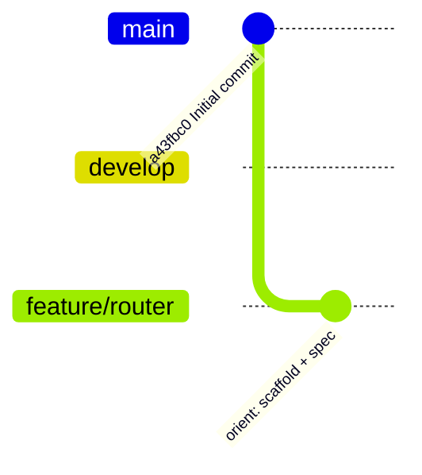

# Status

## Current

| Task                                              | Stage     | Mode     | Ultracode | Updated    |
| ------------------------------------------------- | --------- | -------- | --------- | ---------- |
| Upuaut router library + demo SPA (docs/router.md) | build 4/9 | ATTENDED | yes       | 2026-11-05 |

## Worktrees

| Worktree path                       | Branch         | Task   | Stage | Last commit                     | Next step          | Tier |
| ----------------------------------- | -------------- | ------ | ----- | ------------------------------- | ------------------ | ---- |
| /home/fascio/projects/github/upuaut | feature/router | router | build | see `git log -1 feature/router` | task 5 router core | top  |

## Tasks

| Number | Task                                                                              | File or symbol                                                                | Check                                | Tier      | State |
| ------ | --------------------------------------------------------------------------------- | ----------------------------------------------------------------------------- | ------------------------------------ | --------- | ----- |
| 1      | Errors and failure types                                                          | src/errors.ts `UpuautError`, `NavigationFailure`                              | tests/errors.test.ts                 | cheap     | done  |
| 2      | Query parse/stringify                                                             | src/query.ts `parseQuery`, `stringifyQuery`                                   | tests/query.test.ts                  | cheap     | done  |
| 3      | Path compile, match, rank (spec §3)                                               | src/path.ts `compilePath`, `rankPath`                                         | tests/path.test.ts                   | top       | done  |
| 4      | History backends (spec §7)                                                        | src/history.ts `createMemoryHistory`, `createWebHistory`, `createHashHistory` | tests/history.test.ts                | top       | done  |
| 5      | Router core: resolve, push/replace, guards, redirects, lazy, failures (spec §4-6) | src/router.ts `createRouter`                                                  | tests/router.test.ts                 | top       | todo  |
| 6      | `<upuaut-router>`, `<upuaut-view>`, `<upuaut-link>` (spec §8)                     | src/components/*.ts                                                           | tests/components/*.test.ts           | top       | todo  |
| 7      | Public exports                                                                    | src/index.ts                                                                  | `npm run typecheck`, `npm run build` | cheap     | todo  |
| 8      | Demo SPA (spec §11)                                                               | demo/                                                                         | `npm run build:demo`                 | cheap     | todo  |
| 9      | README                                                                            | README.md                                                                     | `npm run format:check`               | cheap     | todo  |
| 10     | Review squashed diff vs develop                                                   | —                                                                             | findings fixed                       | top       | todo  |
| 11     | Full gate, maps, debrief                                                          | .claude/maps/                                                                 | `npm run check`                      | cheap+top | todo  |

## Decisions

| Date       | Decision                                                                     | Reason                                                                 | By                         |
| ---------- | ---------------------------------------------------------------------------- | ---------------------------------------------------------------------- | -------------------------- |
| 2026-11-05 | "khunm" = khnum ^1.0.0 (npm, ../khnum)                                       | npm has no "khunm"; sibling repo khnum is the user's web-component lib | user                       |
| 2026-11-05 | git flow init -d; work on feature/router                                     | user: git flow                                                         | user                       |
| 2026-11-05 | Single package: lib in src/, SPA in demo/                                    | smallest setup; demo uses lib via alias                                | AFK-style default, at gate |
| 2026-11-05 | Toolchain copied from khnum (TS 7, Vite 8, Vitest 5, happy-dom, prettier)    | consistency with the dependency                                        | user (stack)               |
| 2026-11-05 | Maps written at Finish                                                       | empty repo                                                             | user                       |
| 2026-11-05 | API modeled on Vue Router + React Router                                     | user request                                                           | user                       |
| 2026-11-05 | Option 1: web + memory + hash history; no declarative `<upuaut-route>` in v1 | gate                                                                   | user                       |
| 2026-11-05 | khnum confirmed                                                              | user reply                                                             | user                       |
| 2026-11-05 | Tasks 1-2 done by top tier directly                                          | smaller than a brief                                                   | AFK-style default          |
| 2026-11-05 | Nested `*` joins to parent (`/users/*`)                                      | nested catch-all stays scoped                                          | top tier                   |
