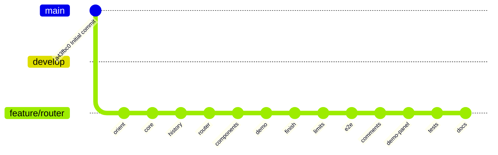

# Status

## Current

| Task                                              | Stage         | Mode     | Ultracode | Updated    |
| ------------------------------------------------- | ------------- | -------- | --------- | ---------- |
| Upuaut router library + demo SPA (docs/router.md) | release 0.1.0 | ATTENDED | no        | 2026-11-05 |

## Worktrees

| Worktree path                       | Branch         | Task   | Stage  | Last commit                     | Next step                                           | Tier |
| ----------------------------------- | -------------- | ------ | ------ | ------------------------------- | --------------------------------------------------- | ---- |
| /home/fascio/projects/github/upuaut | feature/router | router | finish | see `git log -1 feature/router` | user: review, then `git flow feature finish router` | top  |

## Tasks

| Number | Task                                                                              | File or symbol                                                                | Check                                | Tier      | State |
| ------ | --------------------------------------------------------------------------------- | ----------------------------------------------------------------------------- | ------------------------------------ | --------- | ----- |
| 1      | Errors and failure types                                                          | src/errors.ts `UpuautError`, `NavigationFailure`                              | tests/errors.test.ts                 | cheap     | done  |
| 2      | Query parse/stringify                                                             | src/query.ts `parseQuery`, `stringifyQuery`                                   | tests/query.test.ts                  | cheap     | done  |
| 3      | Path compile, match, rank (spec §3)                                               | src/path.ts `compilePath`, `rankPath`                                         | tests/path.test.ts                   | top       | done  |
| 4      | History backends (spec §7)                                                        | src/history.ts `createMemoryHistory`, `createWebHistory`, `createHashHistory` | tests/history.test.ts                | top       | done  |
| 5      | Router core: resolve, push/replace, guards, redirects, lazy, failures (spec §4-6) | src/router.ts `createRouter`                                                  | tests/router.test.ts                 | top       | done  |
| 6      | `<upuaut-router>`, `<upuaut-view>`, `<upuaut-link>` (spec §8)                     | src/components/*.ts                                                           | tests/components/*.test.ts           | top       | done  |
| 7      | Public exports                                                                    | src/index.ts                                                                  | `npm run typecheck`, `npm run build` | cheap     | done  |
| 8      | Demo SPA (spec §11)                                                               | demo/                                                                         | `npm run build:demo`                 | cheap     | done  |
| 9      | README                                                                            | README.md                                                                     | `npm run format:check`               | cheap     | done  |
| 10     | Review squashed diff vs develop                                                   | —                                                                             | findings fixed                       | top       | done  |
| 11     | Full gate, maps, debrief                                                          | .claude/maps/                                                                 | `npm run check`                      | cheap+top | done  |

## Decisions

| Date       | Decision                                                                                                                  | Reason                                                                                 | By                         |
| ---------- | ------------------------------------------------------------------------------------------------------------------------- | -------------------------------------------------------------------------------------- | -------------------------- |
| 2026-11-05 | "khunm" = khnum ^1.0.0 (npm, ../khnum)                                                                                    | npm has no "khunm"; sibling repo khnum is the user's web-component lib                 | user                       |
| 2026-11-05 | git flow init -d; work on feature/router                                                                                  | user: git flow                                                                         | user                       |
| 2026-11-05 | Single package: lib in src/, SPA in demo/                                                                                 | smallest setup; demo uses lib via alias                                                | AFK-style default, at gate |
| 2026-11-05 | Toolchain copied from khnum (TS 7, Vite 8, Vitest 5, happy-dom, prettier)                                                 | consistency with the dependency                                                        | user (stack)               |
| 2026-11-05 | Maps written at Finish                                                                                                    | empty repo                                                                             | user                       |
| 2026-11-05 | API modeled on Vue Router + React Router                                                                                  | user request                                                                           | user                       |
| 2026-11-05 | Option 1: web + memory + hash history; no declarative `<upuaut-route>` in v1                                              | gate                                                                                   | user                       |
| 2026-11-05 | khnum confirmed                                                                                                           | user reply                                                                             | user                       |
| 2026-11-05 | Tasks 1-2 done by top tier directly                                                                                       | smaller than a brief                                                                   | AFK-style default          |
| 2026-11-05 | Nested `*` joins to parent (`/users/*`)                                                                                   | nested catch-all stays scoped                                                          | top tier                   |
| 2026-11-05 | Route ties: deeper chain wins (`/users` + child `""` → child)                                                             | Vue-like nested index routes                                                           | top tier                   |
| 2026-11-05 | Aborted pop restores URL with `history.replace(from)` (no delta tracking)                                                 | v1 simplicity; back entry may be rewritten                                             | top tier                   |
| 2026-11-05 | Lazy component result cached by writing `record.component`                                                                | simplest cache; view reads record directly                                             | top tier                   |
| 2026-11-05 | View/link wait for `<upuaut-router>` upgrade (`connectRouter` + `whenDefined`)                                            | demo smoke test found HTML-first usage threw: dependencies are defined before the host | top tier                   |
| 2026-11-05 | Demo smoke test tests/demo.test.ts (happy-dom) instead of browser e2e                                                     | e2e only on request                                                                    | top tier                   |
| 2026-11-05 | Review findings in .claude/outputs/review.md; limitations 2-4 accepted for v1                                             | review                                                                                 | top tier                   |
| 2026-11-05 | Limits round: implement 1 (history positions), 2 (class check), 3 (Vitest browser mode), 4 (tools)                        | user "implement them"                                                                  | user                       |
| 2026-11-05 | Limit 3 uses Vitest browser mode + Playwright Chromium (not standalone Playwright e2e)                                    | reuses existing tests                                                                  | AFK                        |
| 2026-11-05 | Silent pop via `go(delta, false)` + position in `history.state.upuautPosition`                                            | Vue Router approach                                                                    | AFK                        |
| 2026-11-05 | `test:browser` kept out of `npm run check`                                                                                | browser tests on request; check stays fast and offline                                 | AFK                        |
| 2026-11-05 | Review of limits diff: no blocking findings (see .claude/outputs/review.md rows 6-8)                                      | review                                                                                 | top tier                   |
| 2026-11-05 | Playwright e2e in e2e/ against built demo via `vite preview`; `test:e2e` outside `check`                                  | user request; needs a server and a browser                                             | user / AFK                 |
| 2026-11-05 | Add antirez-style comments (design, why, function, teacher, checklist; no trivial/debt/backup) to src/                    | user request overrides the default low comment density                                 | user                       |
| 2026-11-05 | Demo control panel + styles; demo router split into demo/router.ts, settings, log; 7 new e2e tests                        | user request                                                                           | user                       |
| 2026-11-05 | Remaining work tracked in TODO.md (repo root)                                                                             | user request                                                                           | user                       |
| 2026-11-05 | Release and CI postponed                                                                                                  | user                                                                                   | user                       |
| 2026-11-05 | Missing tests: 27 edge-case tests, host.test.ts for pre-definition path                                                   | coverage gaps                                                                          | AFK                        |
| 2026-11-05 | TypeDoc in tools/typedoc (own package, TS 6.0.3): root TS 7 has no JS API and npm overrides cannot reroute typedoc's peer | docs generation                                                                        | AFK                        |
| 2026-11-05 | docs/roadmap.md explains gaps + out-of-scope; docs/guide.md recipes; all exports documented (notDocumented gate)          | user request                                                                           | AFK                        |
| 2026-11-05 | Merge feature/router into develop with `-k` (branch kept); push master, develop, feature/router                           | user request; branch deletion not requested                                            | user                       |
| 2026-11-05 | Release 0.1.0 via git flow; CHANGELOG, repository/homepage/bugs fields, `prepublishOnly: npm run check`; publish to npm   | user request                                                                           | user                       |

## Assumptions

- "implement them" includes limit 3, so it counts as permission to download Playwright Chromium.
- Limit 2: class check plus `customElements.getName` (no `lazy:` field).
