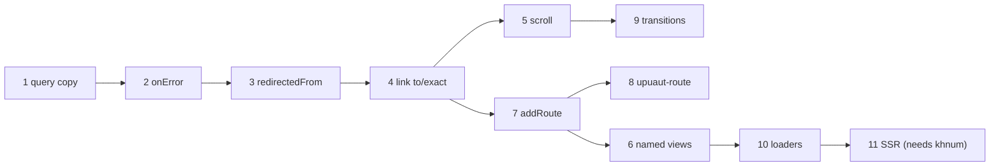

# Roadmap: v1 gaps and out-of-scope features

This page explains what each remaining item in [TODO.md](../TODO.md) means, why it matters, how Vue Router and React Router handle it, and a proposed design for Upuaut. Effort: S (hours), M (a day or two), L (several days).

| Item                                                        | Kind         | Effort | Status                                |
| ----------------------------------------------------------- | ------------ | ------ | ------------------------------------- |
| [Copy the query object](#1-copy-the-query-object)           | gap          | S      | done                                  |
| [Error hook](#2-error-hook-routeronerror)                   | gap          | S      | done                                  |
| [`redirectedFrom`](#3-redirectedfrom)                       | gap          | S      | done                                  |
| [Link: object `to`, `exact`](#4-link-object-to-and-exact)   | gap          | S      | done                                  |
| [Scroll behavior](#5-scroll-behavior)                       | out of scope | M      | planned                               |
| [Named views](#6-named-views)                               | out of scope | M      | planned                               |
| [Dynamic routes](#7-dynamic-routes-addroute--removeroute)   | out of scope | M      | planned                               |
| [Declarative `<upuaut-route>`](#8-declarative-upuaut-route) | out of scope | M      | planned                               |
| [Transitions](#9-transitions)                               | out of scope | M      | planned                               |
| [Data loaders and actions](#10-data-loaders-and-actions)    | out of scope | L      | planned                               |
| [SSR](#11-ssr)                                              | out of scope | L      | planned (may break the component API) |

## v1 gaps

Small holes in features that v1 already has. **All four are done**; the sections below keep the rationale.

### 1. Copy the query object

**Now.** `router.push({path: "/search", query: q})` stores the caller's `q` object in `route.query`. If the caller later changes `q`, the current route changes too, without a navigation.

**Done.** `resolve()` copies the object and its array values. Vue Router normalizes the query into a new object for the same reason.

### 2. Error hook: `router.onError()`

**Now.** `push()` rejects when a guard or a lazy loader throws, so the caller can catch it. But back/forward navigations (pops) and clicks on `<upuaut-link>` have no caller: their errors only go to `console.error`. A failed lazy chunk (e.g. after a deploy) is the common case.

**Others.** Vue Router has `router.onError(handler)`. React Router has an `errorElement` per route.

**Done.** `router.onError((error) => void): () => void`. Every navigation error (push, replace, pops, links, the initial navigation) goes to the handlers, or to `console.error` when there are none; `push`/`replace` still reject. A typical handler reloads the page when a chunk fails to load.

### 3. `redirectedFrom`

**Now.** After `/old-user/3` → `/users/3` or a guard redirect to `/login`, the page cannot tell that a redirect happened or where the user wanted to go (the demo passes it by hand in `?redirect=`).

**Others.** Vue Router sets `to.redirectedFrom` to the first location of the chain.

**Done.** `RouteLocation.redirectedFrom` holds the first requested location, for record and guard redirects.

### 4. Link: object `to` and `exact`

**Now.** `<upuaut-link to="...">` only takes a string, so named routes cannot be used from markup. The active class is a path prefix match, so a link to `/users` is active on every `/users/*` page and there is no way to turn that off.

**Others.** Vue's `<RouterLink :to="{name: 'user', params}">`; React's `<NavLink end>` for exact matching.

**Done.** The `to` **property** accepts any `RouteLocationRaw` (the attribute stays a string); the `exact` attribute applies the active class only on an exact match. An unknown name renders a link without `href` and logs the error.

## Out of v1 scope

Features that v1 left out on purpose (spec section 10).

### 5. Scroll behavior

**Problem.** A single-page app keeps the scroll position of the previous page. Users expect: top of the page on a new navigation, the old position on Back, the element on `#hash`. Today the demo's Docs page scrolls to the hash by hand.

**Others.** Vue Router: `createRouter({scrollBehavior(to, from, savedPosition)})`. React Router: `<ScrollRestoration />`.

**Design.** `scrollBehavior` option, called after the view has rendered. Saved positions are stored per history position — the `upuautPosition` already in `history.state` is the key. Set `history.scrollRestoration = "manual"` while active.

### 6. Named views

**Problem.** Some layouts render more than one part per route, e.g. a main area and a sidebar that both change with the URL.

**Others.** Vue Router: `components: {default: Main, sidebar: Side}` with `<RouterView name="sidebar">`.

**Design.** `components?: Record<string, RouteComponent>` on the record; `<upuaut-view name="sidebar">` (the attribute is already reserved) renders `matched[depth].components[name]`. Depth counting stays per view tree.

### 7. Dynamic routes: `addRoute()` / `removeRoute()`

**Problem.** Plugins, feature flags and permission-based menus add routes after the router starts.

**Others.** Vue Router: `router.addRoute(parentName?, record)`, `router.removeRoute(name)`, `router.hasRoute(name)`, `router.getRoutes()`.

**Design.** Same API. The matcher list is rebuilt and re-sorted on each change (cheap for tens of routes). If the current URL matched the catch-all, re-resolve it after `addRoute`.

### 8. Declarative `<upuaut-route>`

**Problem.** Some apps prefer to declare routes in HTML next to the layout, not in a config object.

**Others.** React Router: `<Routes><Route path element/></Routes>`.

**Design.** `<upuaut-route path="/users/:id" component="user-page" name="user">` children of `<upuaut-router>` (or of another `<upuaut-route>` for nesting), turned into `RouteRecord`s with `addRoute()` (item 7) when they connect. Depends on item 7.

### 9. Transitions

**Problem.** Animate the old page out and the new page in.

**Others.** Vue: `<Transition>` around `<RouterView>`. Browsers now offer the View Transitions API (`document.startViewTransition`).

**Design.** An opt-in `transition` attribute on `<upuaut-view>` that wraps the DOM swap in `document.startViewTransition()` when available, and does a plain swap otherwise. No animation code in the library: styles live in CSS (`::view-transition-old/new`).

### 10. Data loaders and actions

**Problem.** Pages fetch data after they render, so the user sees a blank page, then a spinner, then the content. Loaders fetch in parallel with the navigation and render only when the data is there.

**Others.** React Router: `loader` and `action` per route, `useLoaderData()`, form submissions through actions, revalidation after actions.

**Design.** `loader?: (to, {signal}) => Promise<unknown>` on records; run after guards, in parallel for all entered records, cancelled through `AbortSignal` when a newer navigation wins (the navigation ticket already exists). The data is handed to the page as a `data` property next to `route`. Actions are a larger, separate step.

### 11. SSR

**Problem.** Render the first page on the server for speed and SEO.

**Needs.** The router core already runs without a DOM (memory history). Missing: rendering khnum components to HTML on the server, and hydrating them in the browser. That is mostly a khnum feature (Declarative Shadow DOM or light-DOM string rendering), so it belongs after khnum supports it.

## Suggested order

